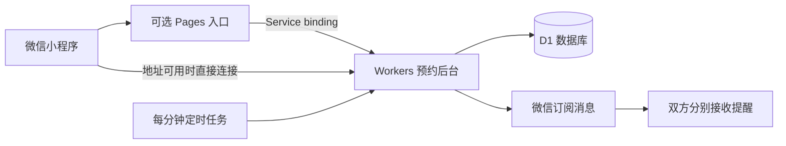

# 有约 · 我的第一个 AI 辅助开发项目

一个用于私人会面与咨询预约的微信原生小程序。选择时间、活动内容和地点，邀请另一位用户确认，支持取消、双方确认改期与活动前一天的提醒。

这是我通过与 AI 协作完成的第一个完整应用项目：从需求和页面，到后台、数据规则、测试、部署与真实设备排障。项目中的 AI 用于辅助开发，预约功能本身不需要调用 AI 模型。

**当前状态：开发与真机联调中。** 仓库默认运行本机演示；用户已反馈 iQOO、华为和苹果手机连接可用，一台 OPPO 仍报微信域名校验错误，设备型号与运行环境待进一步核对。微信分享认证、该设备的连接问题及双方消息送达仍需继续验收，不能把自动测试通过当作正式上线成功。

## 功能

- 私人会面、咨询交流、咖啡小聚、线上沟通与自定义活动。
- 日期、时间、时长、地点、称呼与备注。
- 一对一邀请、确认、婉拒和取消。
- 已确认预约改期需对方同意；未同意前原时间仍有效。
- 双方时间冲突检查、参与权限校验与重复操作保护。
- 双方分别授权微信订阅提醒，活动开始前 24 小时发送。
- 本机演示模式、浏览器预览与独立手机连接检测页。

## 先体验演示

### 微信开发者工具

1. 下载或克隆本仓库，用微信开发者工具导入仓库根目录。
2. 公开配置使用 `touristappid` 和 `demoMode: true`；工具若要求账号，可填自己的小程序 AppID。选择不使用腾讯云服务。
3. 点击编译，创建预约，再使用“切换身份”体验受邀人确认、改期与取消。

演示数据仅在本机，身份和通知为模拟；分享和跨设备同步需要真实接入。

### 浏览器预览

使用 Node.js 24，在仓库根目录运行：

```text
npm run preview
```

打开 http://127.0.0.1:4173 。也可以直接打开 `preview/index.html`。浏览器预览展示基础预约流程，完整改期流程以原生小程序为准。

## 架构



客户端使用微信原生 JS、WXML、WXSS；后台使用 JavaScript、Workers、D1 和定时任务。测试使用 Node.js 内置测试工具和 SQLite，根目录检查不需要安装额外依赖。

## 真实接入

阅读 [新手开始](新手开始.md) 和 [免费后台部署说明](free-backend/README.md)。需要自己的微信 AppID、后台地址、数据库编号、消息模板及 Secret 配置。若默认后台域名在手机网络不可用，可先验证 [Pages 入口](free-entry/网页部署步骤.md)，再绑定原后台。

仓库没有绑定个人的真实服务。AppSecret 和登录签名密钥只填写在服务端 Secret，不能提交到仓库。Workers/Pages 的免费用量有上限，微信账号认证、备案、域名和类目要求仍以平台实际校验为准；本项目不能免除平台要求，也不承诺永久免费或无限量。

## 本地检查

```text
npm test
npm run check
```

自动测试覆盖权限、邀请防重、并发确认、时间冲突、取消、双方改期、独立提醒、失败重试、网络不确定结果、会话签名及入口转发。CI 会在提交和 Pull Request 时执行同样的检查。

真机验收需另行验证两台手机能直接连接、双方确认和授权、提醒送达、取消以及改期。已发送的消息无法撤回；网络结果不明时不会盲目重发。

## 目录

| 目录 | 用途 |
| --- | --- |
| `miniprogram/` | 微信原生客户端与手机检测页 |
| `free-backend/` | Workers、D1、会话与提醒实现 |
| `free-entry/` | 可选 Pages 服务入口 |
| `tests/` | 自动化检查 |
| `scripts/` | 打包、配置检查和预览 |
| `preview/` | 浏览器演示 |
| `backend/`、`cloudfunctions/`、`database/` | 初期腾讯云方案参考，当前免费方案无需开通 |

## AI 协作记录

见 [我的第一个 AI 项目](docs/AI_PROJECT.md)：需求如何拆解、实际踩过的网络和编译问题，以及哪些功能仍在验证。这份仓库会随着实际测试结果继续迭代。

维护者：[zhangxichengcz](https://github.com/zhangxichengcz)
